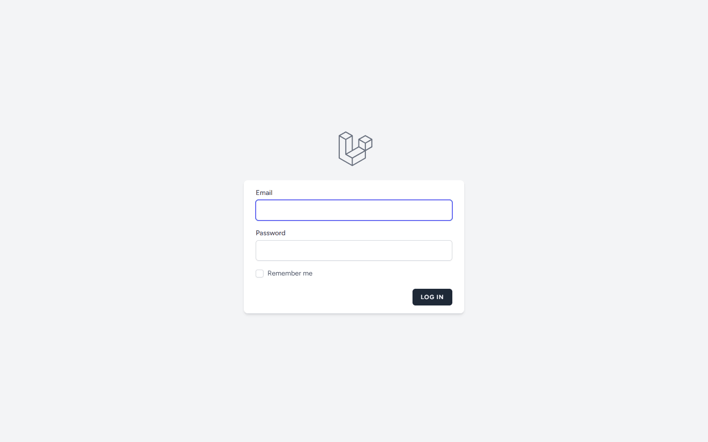
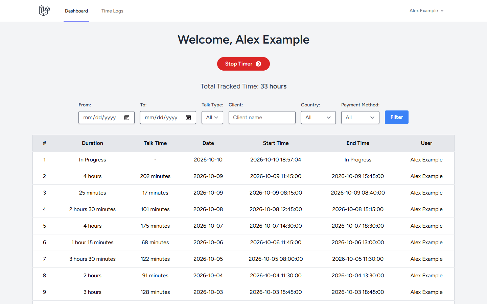
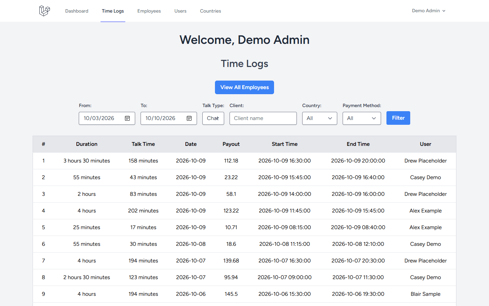
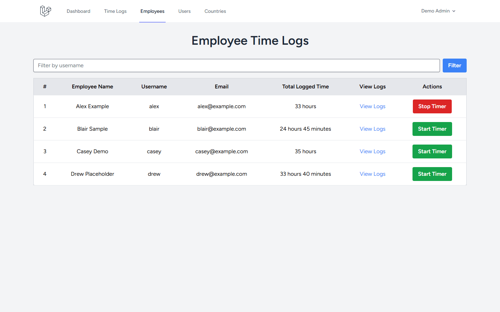
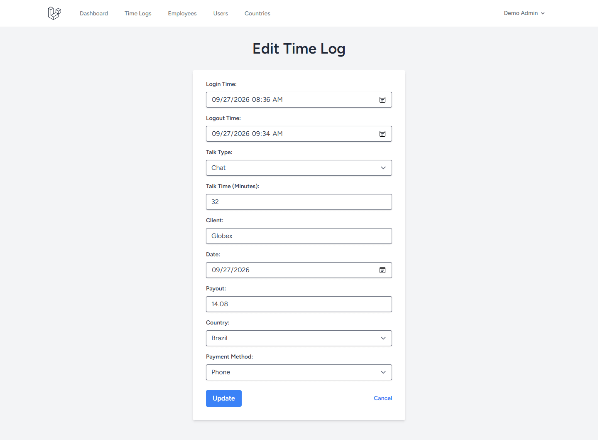

# Time Tracker: employee time logging for a small team

[](https://github.com/ali-hassan-dev/time-tracker/actions/workflows/tests.yml)

A Laravel 13 app where employees clock their own hours and admins review, correct, and manage everything in one place.

I built it for a client on Upwork, who rated the work five stars with the review **"Excellent Laravel Developer."** The code is public with the client's permission.

## What it does

**For employees**
- One-click start and stop timer (Livewire), so a session is logged without a page reload.
- The timer picks up an open session when you come back, so a running session is never lost, and a second tab can't open a duplicate one.
- Their own time logs and total tracked time, with durations shown in plain language (for example "2 hours 15 minutes").

**For admins**
- **Users:** create, edit, and delete accounts with a unique username and email, a role, and a password (min. 8 characters, confirmed).
- **Employees:** search by username, and start or stop any employee's timer for them.
- **Time logs:** view, edit, and delete any employee's logs, including the session details the client uses for payroll: session type and length, client, payout, country, and payment method.
- **Filters:** narrow logs by date range, session type, client, country, and payment method. Lists are paginated, 25 logs per page.
- **Countries:** manage the country list (unique name and 3-letter code). A log's country must match an entry in this list.

## Screenshots

**Login**



**Employee dashboard with the timer running**



**Admin time logs with filters applied**



**Admin employees list**



**Admin editing a time log**



## Roles and permissions

**Admins** can:
- see every employee's time logs, including payout, and filter them;
- edit or delete any log (a log is only reachable through its owner's URL, otherwise the page is a 404);
- create, edit, and delete users, except that an admin can't delete their own account or remove the last admin;
- see the employees list and start or stop any employee's timer;
- manage the country list.

**Employees** can:
- start and stop their own timer;
- see only their own time logs and total time, without the payout column;
- update their name, email, and password on the profile page.

Employees get a 403 on the employees page, on the admin timer, and on every `/admin` page. They can't delete their own account, because deleting a user also deletes their time logs; admins manage accounts. Public registration is off by default (`REGISTRATION_ENABLED=false`), since admins create users.

## How it's built

- **Two roles in a PHP enum** (`admin`, `employee`). Admin routes sit behind an `access-admin` gate, and the finer rules live in `TimeLogPolicy` and `UserPolicy`, so access is enforced on the server, not just hidden in the UI.
- **Validation on every write**, in Form Requests: unique usernames, emails, and country codes, allowed values for session type and payment method, and an existence check for countries.
- **Livewire 3 components** for the employee timer and the admin's per-employee timer. Both re-check the database before starting or stopping, and the admin timer authorizes every action.
- **Laravel Breeze (Livewire + Volt)** for login, password reset, and profile management.
- **Pest tests** for every permission rule, the timer, the filters, and validation, run by GitHub Actions on PHP 8.3 and 8.4 along with a Laravel Pint style check and a Vite build of the front end.

**Stack:** PHP 8.3 or newer, Laravel 13, Livewire 3, Volt, Blade, Tailwind CSS 4, Vite. SQLite by default; MySQL works by changing `.env`.

## Run it locally

You need PHP 8.3 or newer (with the `pdo_sqlite` extension), Composer, and Node.js 22.12 or newer.

```bash
git clone https://github.com/ali-hassan-dev/time-tracker.git
cd time-tracker
composer install
npm install
cp .env.example .env
php artisan key:generate
php artisan migrate
npm run build
```

`php artisan migrate` offers to create the SQLite database file if it doesn't exist yet.

Create the first admin. The command asks for a name, username, email, and password, and the account is verified right away:

```bash
php artisan app:create-admin
```

Optionally, load demo data: one admin (`admin@example.com`), four employees, and about 60 time logs from the last two weeks. Every demo account uses the password `password`.

```bash
php artisan db:seed --class=DemoSeeder
```

Start the app and log in at `http://localhost:8000`:

```bash
php artisan serve
```

Run the tests:

```bash
php artisan test
```

## License

The client owns this code and agreed to share it for portfolio review. No open source license is granted.

## About me

I'm Ali Hassan, a full-stack engineer working with Laravel, React, Next.js, and Node.js. See more of my work on my [portfolio](https://ali-hassan-dev.netlify.app/upwork), or [work with me on Upwork](https://www.upwork.com/freelancers/~0110268fa5a62812e0).

## After delivery

The version delivered to the client is tagged `v1.0-delivered`. Later commits add permission hardening, tests, CI, and demo data for this public copy. The app was then upgraded from Laravel 11 to Laravel 13 and from Tailwind CSS 3 to 4, with the full test suite passing at every step.
